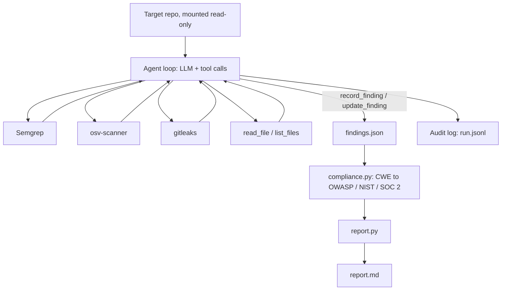

# sec-review-agent

An AI security code review agent. It runs real security scanners, has an LLM verify each finding in the code, hunts for logic bugs the scanners miss, maps confirmed issues to compliance controls, and writes an audit-ready report. Everything runs in a locked-down Docker container.

Built from scratch with raw LLM tool calling (no agent framework), so every step of the loop is visible and controllable.

**Sample output:** [docs/sample-report-nodegoat.md](docs/sample-report-nodegoat.md)

## What it does

1. **Scan.** Runs Semgrep (code patterns), osv-scanner (vulnerable dependencies), and gitleaks (secrets in git history).
2. **Triage.** An LLM agent reads the code around each hit and records a verdict: true positive, false positive, needs review, or duplicate, with reasoning.
3. **Hunt.** The agent reads key routes and data files to find logic bugs scanners can't see, like IDOR and unsafe data flow.
4. **Self-review.** Before finishing, the agent is shown its own findings and must fix wrong verdicts, merge duplicates, and do manual review if it skipped it.
5. **Map.** Each confirmed finding's CWE is mapped to OWASP Top 10:2025, NIST SP 800-53 Rev. 5, and SOC 2 criteria. This step is deterministic, with no LLM.
6. **Report.** Generates a Markdown report with an executive summary, fix-first list, code snippets, dismissed findings, and compliance tables.

## Architecture



## Quick start (Docker)

Requires Docker and a [Gemini API key](https://aistudio.google.com).

```bash
export GEMINI_API_KEY="your-key"
docker build -t sec-review-agent .
mkdir -p out
docker run --rm \
  -e GEMINI_API_KEY -e AGENT_MODEL=gemini-3.5-flash-lite \
  -v /path/to/repo:/target:ro \
  -v "$PWD/out:/out" \
  --cap-drop ALL --security-opt no-new-privileges \
  --memory 2g --cpus 2 --pids-limit 256 \
  sec-review-agent
```

Outputs: `out/reports/report.md`, `out/reports/findings.json`, `out/logs/run.jsonl`.

## Results on OWASP NodeGoat

Tested against [OWASP NodeGoat](https://github.com/OWASP/NodeGoat), a deliberately vulnerable Node.js app.

- Confirmed findings included eval() remote code execution, IDOR, open redirect, ReDoS, insecure session cookies, committed private keys, hardcoded secrets, and critical vulnerable dependencies.
- **Scanners and the agent catch different things.** Semgrep found the eval() injection that the agent missed when reading on its own. The agent found IDOR, NoSQL injection, SSRF, and plaintext passwords that Semgrep missed. Combining them beats either alone.
- **False positives handled:** scanner noise like plain http:// links in tutorial pages was correctly dismissed with reasoning.
- **Honest numbers:** with gemini-3.5-flash-lite (free tier), a run caught 6 of the 10 issues confirmed across earlier runs. Two Docker-vs-local runs confirmed 14 and 12 findings. LLM agents are not deterministic, which is why scanner results and compliance mapping don't depend on the model.

## Design decisions

- **Scanners for precision, LLM for judgment.** Scanners give exact file and line numbers. The LLM decides what is real and finds logic bugs.
- **No agent framework.** The loop is about 100 lines of raw tool calling, so tool access, retries, and limits are explicit.
- **Deterministic compliance mapping.** LLMs make up control IDs, so CWE-to-control mapping is a hand-maintained lookup table.
- **Self-review pass.** A reflection step that measurably reduced duplicates and wrong verdicts compared with a single pass.
- **Provider-agnostic.** Uses the OpenAI-compatible API format, so switching LLM providers is a config change.
- **Model choice matters.** gemini-3.5-flash refused defensive code review entirely; other models in the same family did the task. The model is a config variable for this reason.

## Security and threat model

| Threat | Mitigation |
|---|---|
| Prompt injection from code being scanned | File contents treated as untrusted; injected instructions are flagged as findings. Tested with a planted comment: the agent ignored it. |
| Agent leaking secrets to the LLM provider | `read_file` blocks key and secret files. gitleaks output is redacted. Found and fixed during testing (see below). |
| Secrets leaking into the report | Code snippets are disabled for secret findings and key files. Found and fixed during testing. |
| Path traversal (`../`) | Every file path is resolved and checked to stay inside the target repo. |
| Command injection through tools | Scanners run with fixed argument lists, never `shell=True`. The model can only call an allowlist of tools. |
| Agent modifying the target | Target mounted read-only in Docker; verified with a write test. |
| Tampered scanner downloads | Binaries pinned to exact versions and verified by SHA-256 checksum at build time. |
| Runaway loops or resource use | Step cap, scanner timeouts, and container CPU, memory, and process limits. |
| Hallucinated findings | `record_finding` rejects files that don't exist and invalid verdicts. |
| Accountability | JSONL audit log of every tool call, including blocked attempts. |

**Bugs found in my own agent during testing:**
1. The agent used `read_file` on a private key and sent it to the LLM, bypassing gitleaks' redaction. Fixed by blocking key file types.
2. Report code snippets for secret findings would have printed the secret gitleaks had redacted. Fixed by disabling snippets for secrets.

The repo itself is scanned with gitleaks before pushing.

## Limitations

- Free-tier models miss things. Results vary between runs, and the agent can make confident judgment errors (it repeatedly marked mutable GitHub Action tags as a false positive; they are a real, low-severity supply-chain risk).
- Free-tier Gemini inputs may be used by Google. Only scan public code or code you are authorized to share.
- The compliance mapping is my own judgment and should be verified against official framework sources before use in a real audit.
- This is a starting point for human review, not a replacement for it.

## Project structure

```
agent.py              Agent loop, system prompt, self-review pass, audit log
tools.py              File tools, scanner wrappers, record/update findings
compliance.py         CWE to OWASP / NIST / SOC 2 mapping (no LLM)
report.py             Markdown report generator (no LLM)
data/cwe_controls.json  Mapping table
Dockerfile, entrypoint.sh
docs/                 Sample report, build log
```

## How it was built

See [docs/BUILD_LOG.md](docs/BUILD_LOG.md) for the phase-by-phase notes, including what broke and how it was fixed.

**Only scan code you own or are authorized to test.**